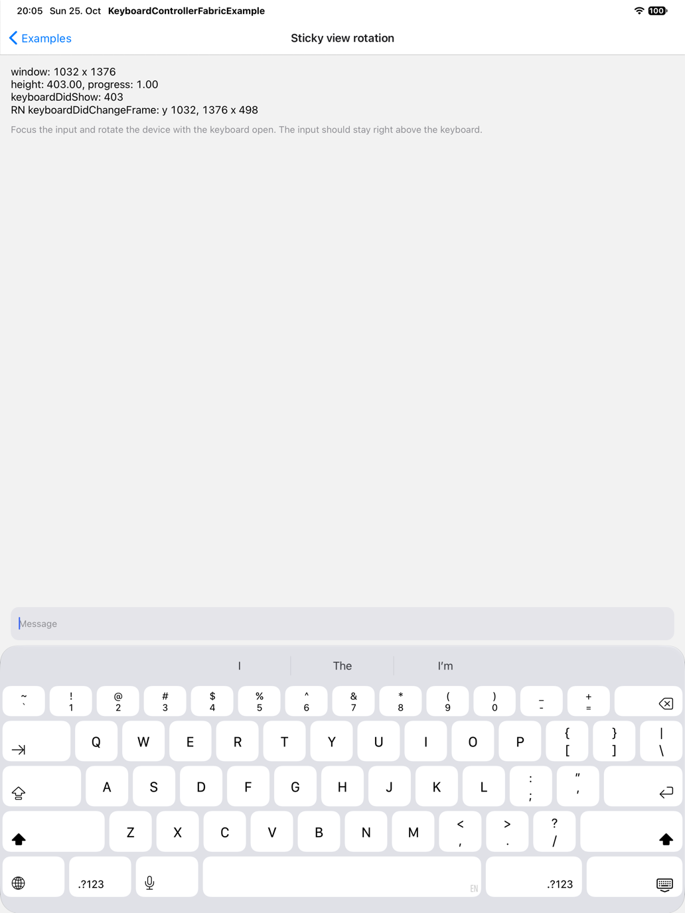
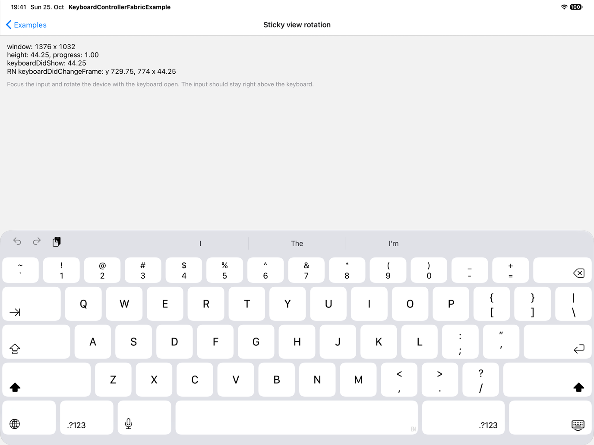
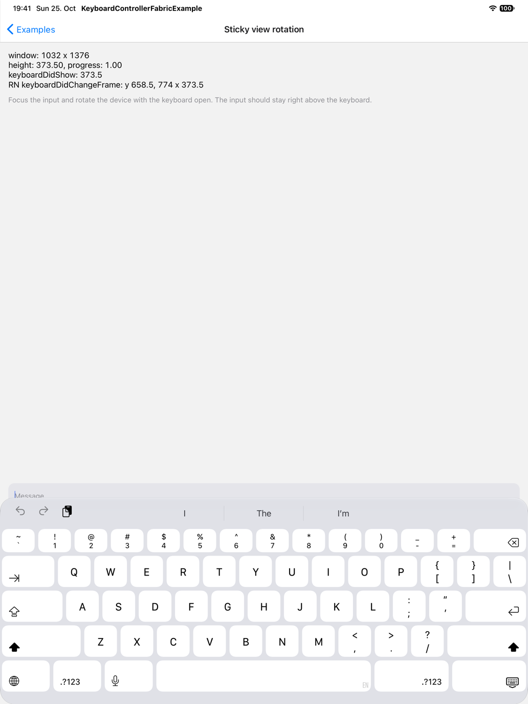

# KeyboardStickyView: wrong keyboard height after rotating a full-screen iPad

This screen keeps a `TextInput` inside a `KeyboardStickyView` at the bottom. The top shows the window size, the height and progress from `useReanimatedKeyboardAnimation` (negated, so an open keyboard reads as positive), the last library `keyboardDidShow` height and the last React Native `keyboardDidChangeFrame` frame. On an iPad Pro 13-inch (M5) simulator with iPadOS 27.0, rotating with the software keyboard open sometimes left the height wrong. The input then sat behind the keyboard.

The branch uses upstream `77c25bdf57fc9007903d2596fc96a6f9022176b7` (package version 1.22.8). Commit `bc0b4cc78bf3924a333aa1266776e0a7db9fa4df` adds the screen as “31. Sticky view rotation” with its navigation entries. One more commit adds this guide and the screenshots. The library source is unchanged, so this branch shows the bug. The screen uses only dependencies FabricExample already has.

## Run on iOS

Use Yarn 1, Xcode and CocoaPods. The Release build embeds the JS bundle, so it does not need Metro.

```sh
git clone --branch codex/repro-ipad-rotation --single-branch https://github.com/Elehiggle/react-native-keyboard-controller.git
cd react-native-keyboard-controller
yarn install --frozen-lockfile
yarn --cwd FabricExample install --frozen-lockfile
cd FabricExample/ios
pod install --no-repo-update
```

Build with the settings of the recorded run, from `FabricExample/ios`:

```sh
nice -n 19 xcodebuild \
  -workspace KeyboardControllerFabricExample.xcworkspace \
  -scheme KeyboardControllerFabricExample -configuration Release \
  -sdk iphonesimulator -destination 'generic/platform=iOS Simulator' \
  -derivedDataPath build -jobs 2 ARCHS=arm64 ONLY_ACTIVE_ARCH=YES \
  IPHONEOS_DEPLOYMENT_TARGET=15.1 build
```

Boot an iPad Pro 13-inch (M5) simulator with iPadOS 27.0, then install and launch the app:

```sh
xcrun simctl install booted build/Build/Products/Release-iphonesimulator/KeyboardControllerFabricExample.app
xcrun simctl launch booted org.reactjs.native.example.KeyboardControllerFabricExample
```

The recorded run reused an existing dependency install, not a fresh clone.

## Reproduce

1. Keep the app full screen and use the software keyboard. Start in portrait.
2. Open **31. Sticky view rotation** and tap the input (`sticky_input`). On this simulator the fresh-open height is 403 pt.
3. Rotate to landscape left with the input focused. Check the readout after 5 s and again after 20 s.
4. Rotate back to portrait. Check again after 5 s and 20 s.
5. Repeat the round trip once. Then restart the app and repeat steps 2–4.
6. Watch for `height: 44.25` in landscape or `height: 373.50` in portrait, with `progress: 1.00` and the input behind the keyboard.

Expected: after rotation settles, the height matches the visible docked keyboard: 498 pt in landscape and 403 pt in portrait on this simulator. The input stays right above it.

The recorded run rotated with Maestro's `setOrientation`, backed by `XCUIDevice`, and took screenshots 5 and 20 seconds after each orientation command returned. It used ten app starts with two round trips each:

| Direction        | Wrong after 5 s | Wrong after 20 s | Wrong height | Fresh-open reference |
| ---------------- | --------------- | ---------------- | ------------ | -------------------- |
| To landscape     | 4/20            | 4/20             | 44.25 pt     | 498 pt               |
| Back to portrait | 3/20            | 3/20             | 373.5 pt     | 403 pt               |

The same seven turns were wrong at both times. These forty turns come from one simulator session and are not independent estimates of a failure rate. Four rotations with the keyboard closed kept height 0 and progress 0.

A later, separate check of the same saved build used three app starts with two round trips each and found no wrong height (0/6 in each direction). The bug does not show in every session.

## Screenshots

All three show the iPad Pro 13-inch (M5) simulator, iPadOS 27.0, on this branch's library code. They are scaled to half size.

Fresh portrait opening, height 403:



Wrong landscape turn, 20 s after the rotation, height 44.25:



Wrong portrait turn, 20 s after the rotation, height 373.5:



The [capture table](repro-media/ipad-rotation/summary.csv) has one row for each of the 80 screenshots: the height and progress read from the screenshot, the expected height, the load check (`validLoad`: one-minute load below 20 before and after the capture), the timing check and whether the turn was wrong. `captureStart` and `captureEnd` are seconds after the orientation command returned.

## Verified environment

- macOS 27.0.1 (26A434), Xcode 27.1 (27A9275)
- iPad Pro 13-inch (M5) simulator, iPadOS 27.0 (24A434), full screen, software keyboard
- React Native 0.87.1, Fabric, Hermes, Release build
- React 19.2.3, Reanimated 4.7.1, Worklets 0.13.0

There is no result for iPhone, a physical device or an older OS. This branch does not contain a fix.
