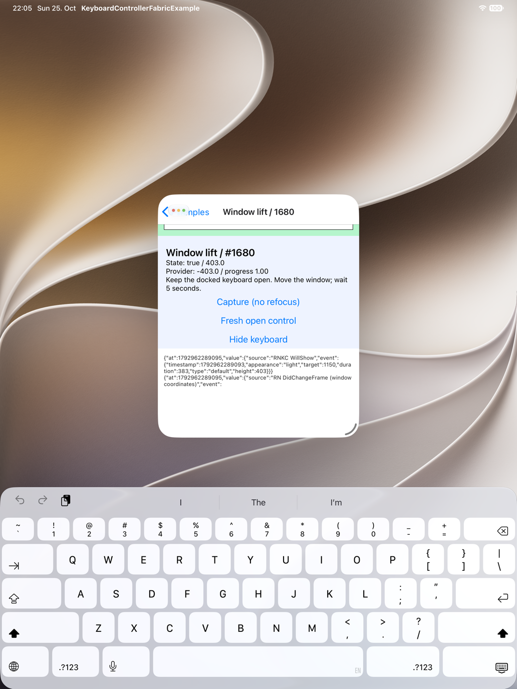
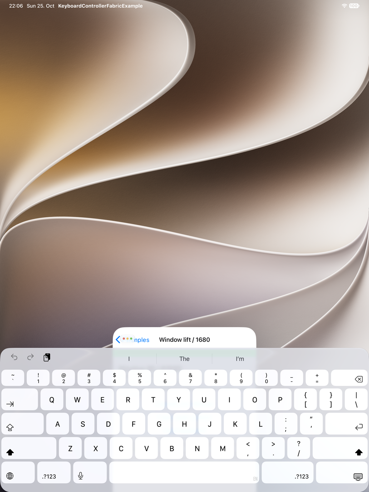
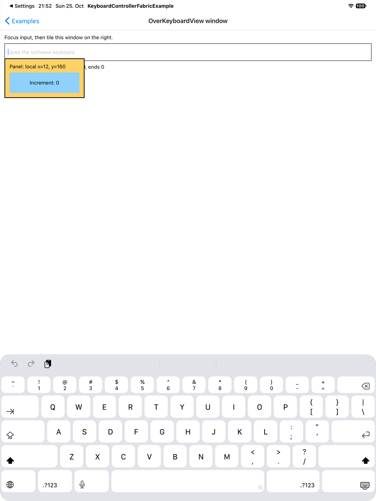
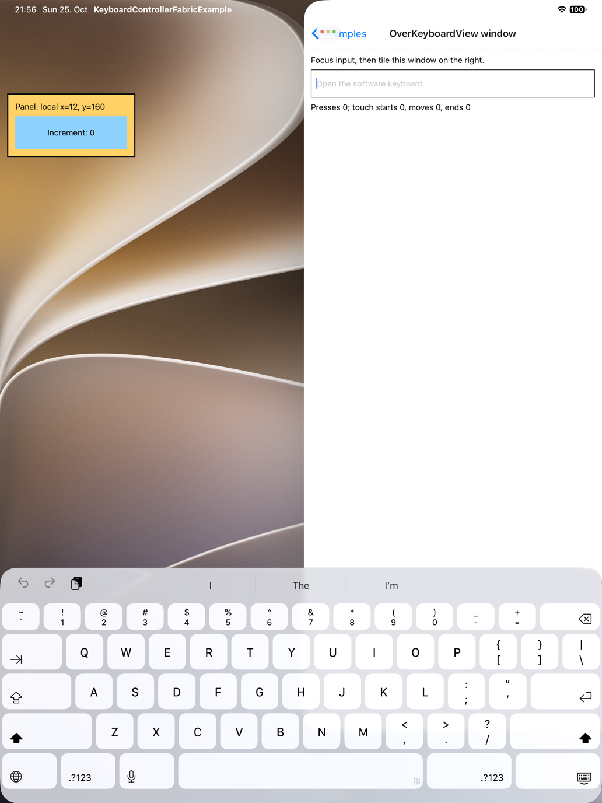

# iPad app windows: keyboard lift and OverKeyboardView placement

This branch adds four example screens for iPad app windows that do not fill the screen. This guide covers two of them:

- **31. Window lift / 1680** shows how far the provider lifts content when a small free window ends above the docked keyboard or reaches below the screen ([#1680](https://github.com/kirillzyusko/react-native-keyboard-controller/issues/1680)).
- **33. OverKeyboardView window** shows where `OverKeyboardView` content lands when the app sits in the right-hand tile.

The other two screens are on the branch, but this guide makes no claim about them:

- **32. KASV window drag**: a `KeyboardAwareScrollView` with a sticky footer, for moving a free window while an input has focus.
- **34. KASV realignment**: a `KeyboardAwareScrollView` with a fixed `bottomOffset` and a `synchronize()` button.

The branch uses upstream `77c25bdf57fc9007903d2596fc96a6f9022176b7` (package version 1.22.8). Four commits up to `6753a4b2b14b15726fa163fe288b1570940bcca5` add the screens and their navigation entries; that is the tested commit. One more commit adds this guide and the media. The library source is unchanged, so this branch shows the bugs. The screens use only dependencies FabricExample already has.

## Run on iOS

Use Yarn 1, Xcode and CocoaPods. The Release build embeds the JS bundle, so it does not need Metro.

```sh
git clone --branch codex/repro-ipad-window --single-branch https://github.com/Elehiggle/react-native-keyboard-controller.git
cd react-native-keyboard-controller
yarn install --frozen-lockfile
yarn --cwd FabricExample install --frozen-lockfile
cd FabricExample/ios
pod install --no-repo-update
```

Build with the settings of the recorded runs, from `FabricExample/ios`:

```sh
nice -n 19 xcodebuild \
  -workspace KeyboardControllerFabricExample.xcworkspace \
  -scheme KeyboardControllerFabricExample -configuration Release \
  -sdk iphonesimulator -destination 'generic/platform=iOS Simulator' \
  -derivedDataPath build -jobs 2 ARCHS=arm64 ONLY_ACTIVE_ARCH=YES \
  IPHONEOS_DEPLOYMENT_TARGET=15.1 build
```

Boot an iPad Pro 13-inch (M5) simulator with iPadOS 27.0, then install and launch the app:

```sh
xcrun simctl install booted build/Build/Products/Release-iphonesimulator/KeyboardControllerFabricExample.app
xcrun simctl launch booted org.reactjs.native.example.KeyboardControllerFabricExample
```

Enable Windowed Apps in Settings → Multitasking & Gestures if needed. The recorded runs reused installed dependencies and an existing DerivedData directory, not a fresh clone. Before the runs, the installed executable and JS bundle matched the saved Release build.

## Window lift / 1680

The screen shows `useKeyboardState` as `State: <visible> / <height>` and the `useReanimatedKeyboardAnimation` height and progress as `Provider`. A lifted provider reads negative. Below are a capture button that does not refocus, a fresh-open button, a hide button and a log of the last ten keyboard events and captures. A `KeyboardStickyView` footer holds the input.

### Reproduce

1. Open **31. Window lift / 1680**. Resize the window to 402×486 pt so it ends above the keyboard area.
2. Focus the input and wait at least 5 seconds.
3. Drag the title bar down until the window reaches slightly below the screen. Wait again.
4. Compare the provider readout and the sticky input with the window bottom and the keyboard top.

Expected: the provider lift matches the part of the window the keyboard covers. It is 0 pt when the window ends above the keyboard.

What `main` showed:

| Case                                               | Window-relative lift reference                                    | Observed                                                                                      |
| -------------------------------------------------- | ----------------------------------------------------------------- | --------------------------------------------------------------------------------------------- |
| Fresh focus, window ends above the docked keyboard | 0 pt                                                              | State visible/403; provider −403, progress 1; the sticky input moves up to the navigation bar |
| Same 402×486 pt window moved down                  | 428 pt, from window height 486 minus the fresh RN keyboard top 58 | State visible/403; provider −403, progress 1; the input stays behind the keyboard             |

The second case implies about 25 pt of window below the screen: the docked keyboard is 403 pt high, but the window-relative reference is 428 pt. This comes from the fresh RN frame and the unchanged window size. It is not a direct native window-origin measurement. The drag also caused a system hide/show cycle without an explicit refocus, so it does not test movement with the keyboard open the whole time. The JS reference uses the last RN event, so it is not fresh native geometry after arbitrary movement.

Upper position, keyboard open:



After the downward drag:



The JS events for both positions, read from that on-screen log, are in [09-above-keyboard-focused-events.jsonl](repro-media/ipad-window/09-above-keyboard-focused-events.jsonl) and [12-after-down-drag-events.jsonl](repro-media/ipad-window/12-after-down-drag-events.jsonl). They are not a complete native trace.

## OverKeyboardView window

The screen has one input. It keeps an `OverKeyboardView` mounted and shows a yellow panel at local x=12, y=160 after `keyboardDidShow`. The panel holds a blue counter button.

### Reproduce

1. In portrait, open **33. OverKeyboardView window**. With the app full screen, focus the input. The panel is at x12/y160 pt.
2. Dismiss the keyboard. Use the window menu to tile the app on the right, then focus the input again. The recorded run used a 511 pt wide right tile that starts at screen x 521 pt on a 1032 pt wide display.
3. Take a screenshot of the whole display. The yellow panel stays at screen x 12 pt, outside the app. It should start at x 533 pt. If your tile differs, derive the expected value from the actual window origin.

Expected: the panel follows the app window. A local x of 12 pt maps to screen x = window x + 12 pt.

| State           | App left edge | Expected panel left edge | Observed panel left edge |
| --------------- | ------------- | ------------------------ | ------------------------ |
| Full screen     | 0 pt          | 12 pt                    | 12 pt                    |
| Right-hand tile | 521 pt        | 533 pt                   | 12 pt                    |

Positions come from the screenshots at two pixels per point. This covers horizontal placement only. Five stationary taps on the visible button raised the count in each state. A small move from (122,227) to (125,229) pt over 0.4 s gave touch callbacks but no press in both states, so it does not point to a window-specific touch problem.

Full screen, panel inside the app:



Right-hand tile, panel outside the app:



## Verified environment

- macOS 27.0.1 (26A434), Xcode 27.1 (27A9275)
- iPad Pro 13-inch (M5) simulator, iPadOS 27.0 (24A434), portrait, software keyboard
- React Native 0.87.1, Fabric, Hermes, Release build
- React 19.2.3, Reanimated 4.7.1, Worklets 0.13.0

The screenshots are scaled to half size. These are simulator results. There is no result for iPhone, a physical device or an older OS, and this branch does not contain a fix.
