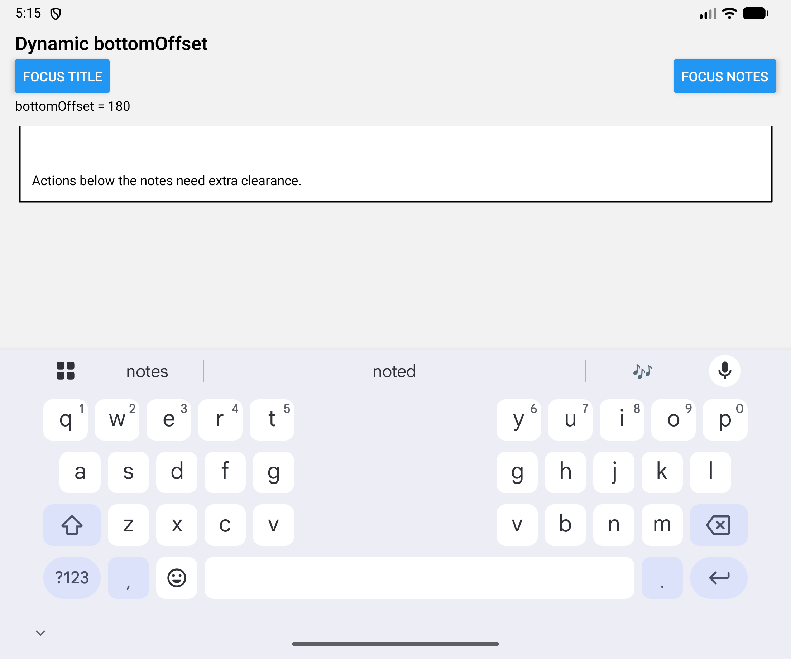
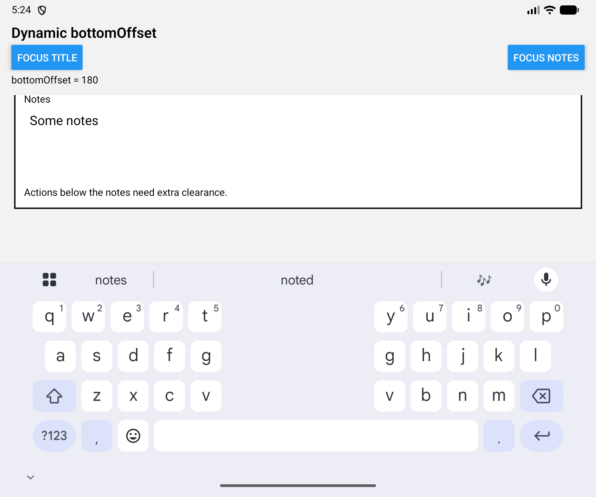

# KeyboardAwareScrollView: bottomOffset changes on focus

This screen has a title input and a multiline notes input. Focusing notes changes `bottomOffset` from 60 to 180. On the unfolded Pixel Fold emulator, the notes input scrolls partly or completely above the form while the keyboard stays open.

The branch uses upstream `4d975973bc8e76d7118b8800cd620b49599a588f` (package version 1.22.7) with a replacement `FabricExample/src/App.tsx`, this guide, and recordings. The library source is unchanged, so this branch demonstrates the bug. The screen uses only React, React Native and react-native-keyboard-controller.

## Run on Android

Use Yarn 1 and the Android toolchain required by FabricExample. The commands below target an arm64 emulator; replace `YOUR_DEVICE` with its ADB serial.

```sh
git clone --branch codex/repro-kasv-bottom-offset --single-branch https://github.com/Elehiggle/react-native-keyboard-controller.git
cd react-native-keyboard-controller
yarn install --frozen-lockfile
cd FabricExample
yarn install --frozen-lockfile
yarn start --port 8083
```

In a second terminal, from `FabricExample/android`:

```sh
./gradlew :app:assembleDebug -PreactNativeArchitectures=arm64-v8a -PreactNativeDevServerPort=8083
adb -s YOUR_DEVICE install -r app/build/outputs/apk/debug/app-debug.apk
adb -s YOUR_DEVICE reverse tcp:8083 tcp:8083
adb -s YOUR_DEVICE shell am start -n com.keyboardcontrollerfabricexample/.MainActivity
```

## Reproduce

1. Open the app on the Pixel Fold's inner display.
2. Press **Focus title** and wait for the keyboard.
3. Press **Focus notes**. The header shows `bottomOffset = 180`.
4. Check the notes input: it can end up above the form, leaving a blank area above the keyboard.
5. Alternate **Focus title** and **Focus notes** without typing.

Expected: the focused notes input and caret stay visible above the keyboard with the larger clearance applied.

In the original-source recording, the input was clipped in all three cycles; how much was hidden varied. Automation can use `focus-title`, `focus-notes`, `title-input`, and `notes-input` test IDs.

## Recordings

Both recordings use the same Android app build and the same screen. The before recording was made after reverting the library change; the after recording uses the proposed JS fix. This reproduction branch contains the original library code, not the fix.

- [Original source, three focus cycles](repro-media/kasv-bottom-offset/before-open.mp4)
- [With the proposed fix, three focus cycles](repro-media/kasv-bottom-offset/after-open.mp4)

Original source:



With the proposed fix:



## Verified environment

- macOS 27.0.1 (26A434)
- Pixel Fold emulator, Android 16 / API 36.1, build BE4B.251210.005
- Inner display: 2208 × 1840 at 420 dpi; outer: 1080 × 2092
- React Native 0.87.1, Fabric, Hermes, debug build
- React 19.2.3, Reanimated 4.7.1, Worklets 0.13.0
- Gboard 18.4.1.985164140-release-arm64-v8a

The before/after comparison covers the inner display. Additional checks with the fix kept the input visible in three cycles on the outer display and after reopening the device. There is no before recording for the outer display. This standalone reproduction has not been tested on iOS.
